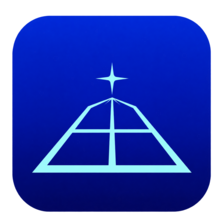
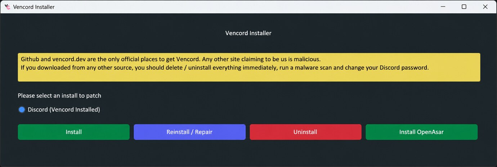

<p align="center">
  
</p>

<h1 align="center">betterDC</h1>

<p align="center">
  <a href="betterDC.theme.css"></a>
  <a href="#quick-installation"></a>
  <a href="https://vencord.dev/"></a>
  <a href="LICENSE"></a>
</p>

betterDC is a CSS theme for Discord desktop with Vencord. It adds a dark blue wallpaper inspired by *Bleach* or your own wallpaper behind the server list, channel list, and chat. The wallpaper fills the window and the main panels are translucent.

betterDC is an independent project unaffiliated with Discord or Vencord.

## Quick installation

### 1. Install Vencord on Windows

Run the official Windows installer, select your Discord installation, and click **Install**. Open Discord afterward. If Vencord is already installed, go to step 2. [Download the Vencord Windows installer](https://github.com/Vencord/Installer/releases/latest/download/VencordInstaller.exe)



### 2. Put the theme and wallpaper in the Themes folder

In Discord, open **User Settings → Appearance** and choose **Dark** or **Midnight**. Under **Vencord**, open **Themes → Local Themes → Open Themes Folder**.

Open each file below and click GitHub's **Download raw file** button. Copy both `betterDC.theme.css` and `betterdc-facades.png` into the Themes folder.

[](betterDC.theme.css)
[](assets/betterdc-facades.png)

### 3. Paste the QuickCSS

Back in **Local Themes**, click **Edit QuickCSS** and paste the full block below. If you already have a betterDC block, replace it with this one. In **User Settings → Vencord**, make sure **Enable Custom CSS** is on.

```css
:root {
    --betterdc-wallpaper-image: url("vencord:///themes/betterdc-facades.png");
    --betterdc-wallpaper-position: center;
    --betterdc-overlay-opacity: 0.38;
    --betterdc-panel-opacity: 0.35;
    --betterdc-glass-blur: 14px;
}

:is(.theme-dark, .theme-darker, .theme-midnight) #app-mount :is(
    [class^="guilds_"], [class*=" guilds_"],
    [class^="sidebarList_"], [class*=" sidebarList_"],
    [class^="chat_"], [class*=" chat_"]
) {
    backdrop-filter: blur(var(--betterdc-glass-blur)) saturate(115%);
    background-image: linear-gradient(rgb(9 17 46 / 0.25), transparent 45%);
    border-radius: 10px;
    box-shadow: inset 0 0 0 1px rgb(155 201 255 / 0.23);
}
```

### 4. Enable betterDC and restart Discord

In **Local Themes**, click **Load missing Themes** if betterDC is missing. Turn on **betterDC**, then quit Discord completely and reopen it.

## Customize or remove the theme

To use another wallpaper, copy it into the Themes folder and change the filename in `--betterdc-wallpaper-image`. You can also use a direct image URL from a Vencord-supported host such as `i.imgur.com`.

Lower `--betterdc-panel-opacity` for more transparent panels, raise `--betterdc-overlay-opacity` for darker wallpaper, or adjust `--betterdc-glass-blur` to change the blur.

To restore Discord's appearance, switch off **betterDC** in **Local Themes** and remove the betterDC block from **Edit QuickCSS**. If you changed your Discord appearance mode, select your previous mode again.
